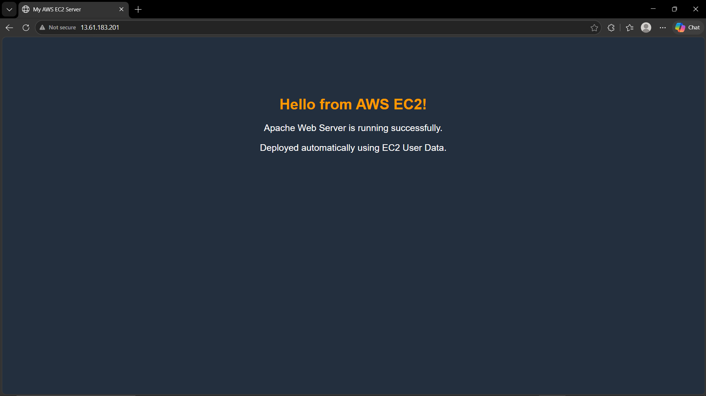

# AWS EC2 Web Server in a Custom VPC

**Architecture diagram:** [Web server EC2 Instance attached to a VPC subnet .drawio.pdf](Web%20server%20EC2%20Instance%20attached%20to%20a%20VPC%20subnet%20.drawio.pdf)



A hands-on project that deploys a web server on **Amazon EC2** inside a custom **VPC** with a public subnet, an Internet Gateway, and a locked-down Security Group. It covers the core AWS networking pieces needed to make an instance reachable from the internet.

## Architecture

```
Internet
   │
   ▼
Internet Gateway (igw-05a5bc692c1bf70e7)
   │
   ▼
Route Table (FirstProject-rtb-public)
   │   0.0.0.0/0      → Internet Gateway
   │   172.16.0.0/16  → local
   ▼
Public Subnet (FirstProject-subnet-public1-eu-north-1a)
   │   CIDR: 172.16.0.0/20
   ▼
Security Group (Web-SG) ──► EC2 instance "web-server"
                            t3.micro, private IP 172.16.14.77
```

## Resources

| Resource | Value |
|---|---|
| Region / AZ | `eu-north-1` (Stockholm) / `eu-north-1a` |
| VPC | `FirstProject-vpc` (`172.16.0.0/16`) |
| Subnet | `FirstProject-subnet-public1-eu-north-1a` (`172.16.0.0/20`, 4096 addresses, 4090 available) |
| Route table | `FirstProject-rtb-public` |
| Internet Gateway | `igw-05a5bc692c1bf70e7` |
| Network ACL | `acl-06006d2ad21e3ecbd` (default) |
| Security Group | `Web-SG` |
| EC2 instance | `web-server`, `t3.micro`, Linux/UNIX |

## Security Group (`Web-SG`)

**Inbound**

| Type | Protocol | Port | Source | Purpose |
|---|---|---|---|---|
| HTTP | TCP | 80 | `0.0.0.0/0` | Public web access |
| SSH | TCP | 22 | `0.0.0.0/0` | Remote administration |

**Outbound**

| Protocol | Port | Destination |
|---|---|---|
| All | All | `0.0.0.0/0` |

> **Security note:** SSH open to `0.0.0.0/0` is fine for learning, but in any real setup restrict port 22 to your own IP (`x.x.x.x/32`). If you serve HTTPS, also add a rule for TCP 443.

## Setup Steps

1. **Create the VPC** with one public subnet in `eu-north-1a` (VPC wizard: "VPC and more").
2. **Verify networking**: the public route table must contain `0.0.0.0/0 → igw-...`.
3. **Create the Security Group** `Web-SG` with the inbound rules above.
4. **Launch the EC2 instance** (`web-server`, `t3.micro`) in the public subnet, attach `Web-SG`, and enable a public IPv4 address (the subnet does not auto-assign one).
5. **Add the User data script** under **Advanced details → User data** before launching. It installs and starts the web server automatically on first boot (see [User Data](#user-data) below).
6. **Test** from a browser: `http://<public-ip>` (use `http`, not `https`). Wait until the status check shows 2/2 or 3/3 passed, plus a minute or two for the script to finish.

## User Data

User data is a script that EC2 runs automatically **once, as root, on the first boot** of the instance. It is used here to bootstrap the web server so no manual SSH setup is needed.

The script installs the **Apache HTTP Server (`httpd`)** on Amazon Linux and creates a custom landing page:

```bash
#!/bin/bash
dnf update -y
dnf install -y httpd
systemctl enable httpd
systemctl start httpd
cat > /var/www/html/index.html <<'EOF'
<!DOCTYPE html>
<html>
<head>
  <title>My AWS EC2 Server</title>
  <style>
    body { background-color: #232f3e; color: white; font-family: Arial, sans-serif; text-align: center; padding-top: 100px; }
    h1 { color: #ff9900; }
    p { font-size: 20px; }
  </style>
</head>
<body>
  <h1>Hello from AWS EC2!</h1>
  <p>Apache Web Server is running successfully.</p>
  <p>Deployed automatically using EC2 User Data.</p>
</body>
</html>
EOF
```

**What each part does**

| Command | Purpose |
|---|---|
| `dnf update -y` | Updates the OS packages |
| `dnf install -y httpd` | Installs Apache |
| `systemctl enable httpd` | Starts Apache automatically on every reboot |
| `systemctl start httpd` | Starts Apache now |
| `cat > /var/www/html/index.html <<'EOF' ... EOF` | Writes the landing page into Apache's web root |

> **Important:** the closing `EOF` must be on its own line, with nothing before it. If it is on the same line as `</html>`, the heredoc is never closed, the script prints a warning, and the word `EOF` ends up inside the page.

## Notes

- The public IPv4 address changes every time the instance is stopped and started. Attach an **Elastic IP** if you need a stable address.
- Stop or terminate the instance when you are done to avoid charges.

## What This Project Demonstrates

- VPC, subnet, and CIDR planning
- Public subnet design with an Internet Gateway and route tables
- Security Groups as a stateful instance-level firewall
- Launching and connecting to EC2 (EC2 Instance Connect / SSH)
- Diagnosing connectivity problems layer by layer